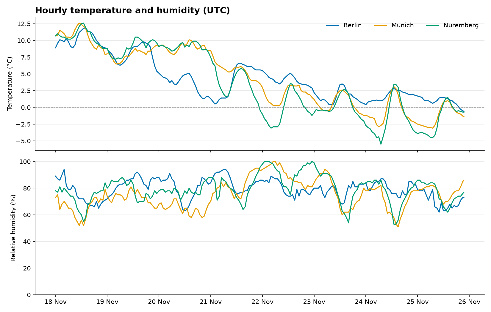
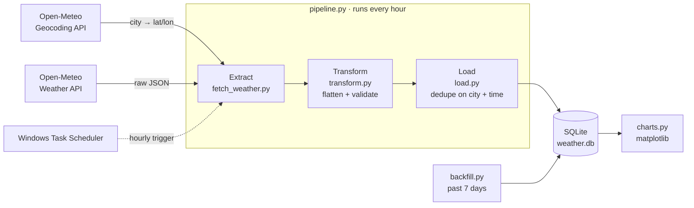
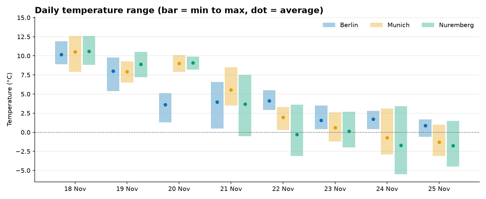

# WeatherFlow ETL

An end-to-end **ETL (Extract → Transform → Load) pipeline** in Python that collects live weather data for German cities every hour, validates it, and stores it in a SQLite database for analysis and visualization.



## How it works



| Stage | File | What it does |
|---|---|---|
| **Extract** | `fetch_weather.py` | Geocodes each city (preferring German matches) and fetches current temperature and humidity from the Open-Meteo API, with request timeouts. |
| **Transform** | `transform.py` | Flattens the nested JSON into one clean record per reading, normalizes timestamps to UTC, and rejects missing or physically impossible values. |
| **Load** | `load.py` | Writes records into SQLite. A `UNIQUE(city, observed_at)` constraint makes every run **idempotent**: re-running never creates duplicates. |
| **Orchestrate** | `pipeline.py` | Runs E → T → L, isolates failures per city so one bad response doesn't stop the run, and logs every run to `data/pipeline.log`. |
| **Schedule** | `schedule_task.ps1` | Registers a Windows scheduled task that runs the pipeline every hour in the background. |
| **Backfill** | `backfill.py` | Loads historical hourly data (default: last 7 days) so analysis can start immediately. |
| **Visualize** | `charts.py` | Generates the charts in this README from the database. |

## Results

Daily temperature range per city. The bar spans the day's minimum to maximum, and the dot is the daily average:



## Database schema

```sql
CREATE TABLE weather_readings (
    id            INTEGER PRIMARY KEY AUTOINCREMENT,
    city          TEXT    NOT NULL,
    latitude      REAL    NOT NULL,
    longitude     REAL    NOT NULL,
    temperature_c REAL    NOT NULL,
    humidity_pct  INTEGER NOT NULL,
    observed_at   TEXT    NOT NULL,   -- UTC, ISO 8601
    fetched_at    TEXT    NOT NULL,   -- when the pipeline ran
    UNIQUE (city, observed_at)
);
```

## Run it yourself

Requires Python 3.10+. No API key is needed.

```powershell
git clone https://github.com/avaisismail01/weatherflow-etl.git
cd weatherflow-etl
python -m venv venv
.\venv\Scripts\activate
pip install -r requirements.txt

python backfill.py      # load the last 7 days of hourly history
python pipeline.py      # run the live ETL once
python charts.py        # regenerate charts into docs/images/

# Optional: run the pipeline automatically every hour (Windows)
powershell -ExecutionPolicy Bypass -File .\schedule_task.ps1
```

## Tech stack

Python · REST APIs (`requests`) · SQLite · matplotlib · Windows Task Scheduler · Git

## Roadmap

- [ ] Unit tests for the transform step
- [ ] Interactive dashboard
- [ ] More cities and weather variables (wind, precipitation)

## Data source

Weather data from [Open-Meteo](https://open-meteo.com/) (CC BY 4.0).
